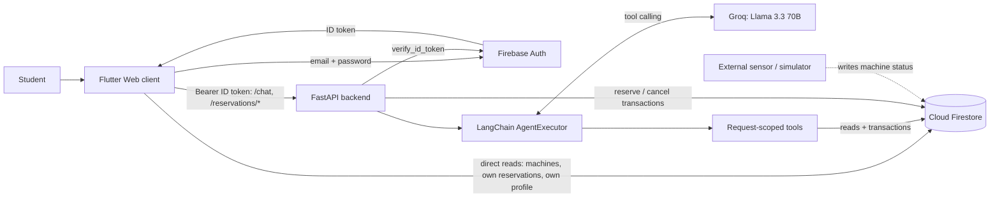
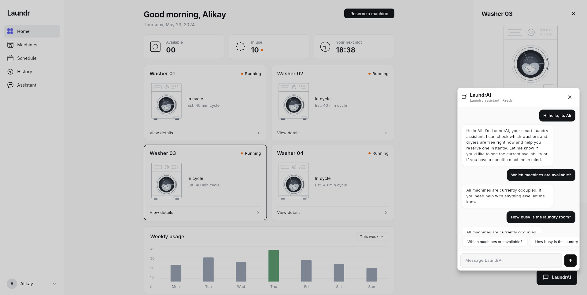
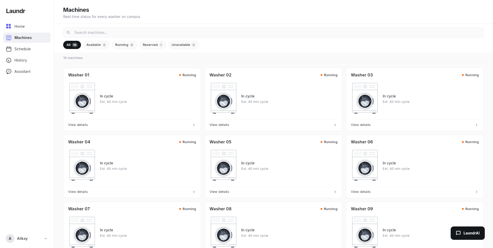
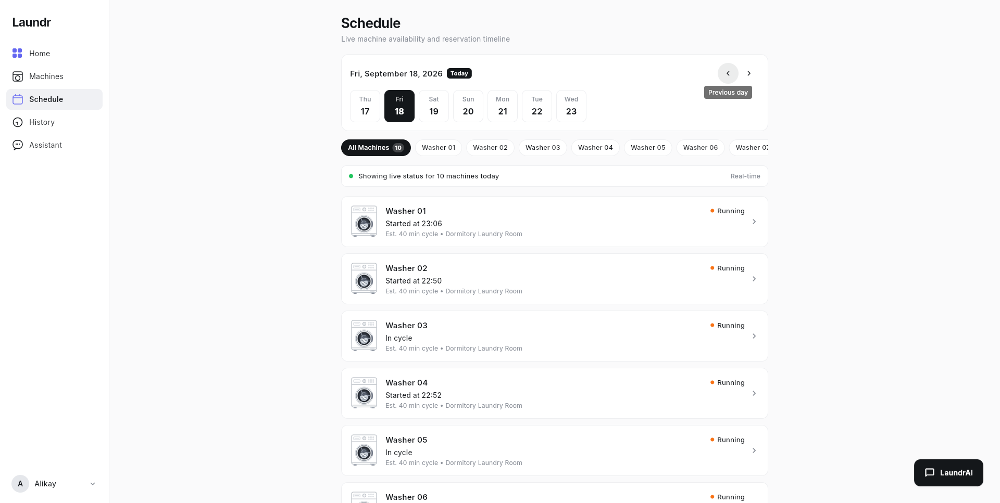
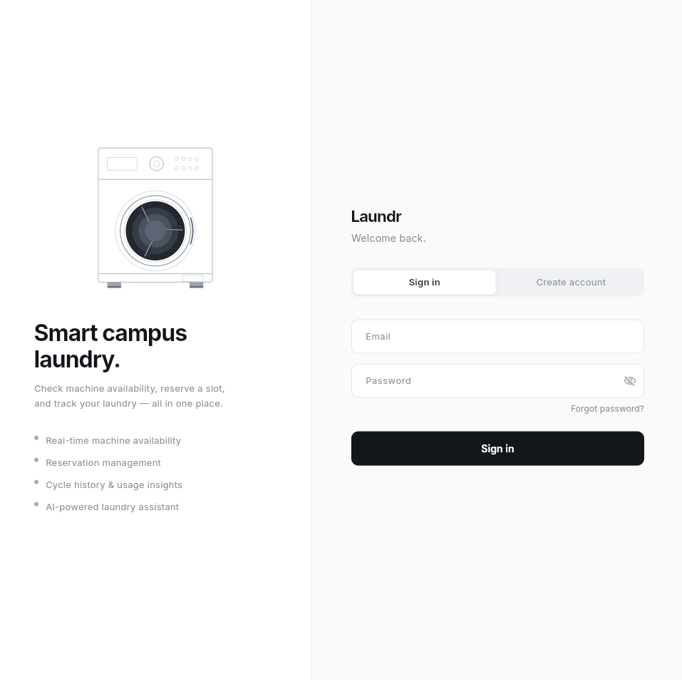

# LaundrAI — Engineering Showcase

LaundrAI is a smart laundry system for shared dormitory washing machines. Students see live machine status, reserve and cancel machines, and talk to an AI assistant that can check availability and reserve a machine on their behalf.

This repository is a **public engineering showcase**. It explains how the system is built and why, using diagrams, a small number of cited source excerpts and selected tests. **The application itself is private and is not included here.** Nothing in this repository can be built or run.

The central engineering question is the boundary between model reasoning and trusted business logic: the language model may *propose* an action, but identity, quotas, ownership and idempotency are enforced by deterministic server code that the model cannot influence.

<p align="center">
  <a href="https://www.youtube.com/watch?v=4BU2yrt2p6U">
    
  </a>
</p>

## At a Glance

| Area | Implementation |
| --- | --- |
| Client | Flutter Web (`provider`, `http`, `firebase_auth`, `cloud_firestore`) |
| Backend | Python, FastAPI, Pydantic, Uvicorn |
| Identity | Firebase Authentication; ID tokens verified server-side with the Firebase Admin SDK |
| Data | Cloud Firestore: `machines`, `users`, `reservations`, `reservationRequests` |
| AI | LangChain `AgentExecutor` with a custom tool-calling agent and output parser; Groq `llama-3.3-70b-versatile`, `temperature=0`, at most 6 iterations |
| Writes | Firestore transactions for reserve and cancel, with hashed idempotency records |
| Tests | 118 tracked Flutter tests (`flutter_test`), 45 backend tests (`unittest` + `unittest.mock`) |

## Status and Scope

- **Prototype.** LaundrAI is a university research prototype developed and evaluated locally. It is **not deployed** and has not run in production. There is no CI pipeline; test results come from local runs.
- **Machine occupancy** is written to Firestore by an external sensor/simulator component that is not part of the application described here. The application consumes the resulting `status` field.
- **Not used:** LangGraph, RAG, embeddings or vector stores, PostgreSQL/pgvector, fine-tuning or LoRA, anomaly detection, Docker, CI/CD, production hosting. The assistant is grounded by tools that read live Firestore state at request time, not by retrieval.

## System Architecture



The client reads Firestore directly for live UI updates. Every reservation write goes through the backend, which is the only authoritative mutation path. The client writes only its own `users/{uid}` profile document.

Details: [docs/architecture.md](docs/architecture.md)

## Engineering Highlights

1. **Server-bound tool identity.** Agent tools are built per request and capture the verified UID in a closure. The LLM-visible schema of `reserve_machine` contains only `machine_id`, so the model has no argument through which it could act as another user. A test asserts the schema. → [docs/ai-tool-calling.md](docs/ai-tool-calling.md)
2. **Deterministic write guard.** Before any reservation, the tool re-reads the user's own message and refuses the write unless that message names the selected machine. A hallucinated or injected machine ID cannot become a reservation. Bare confirmations ("yes", "ok", "tamam") are answered before the model runs.
3. **Transactional reservations.** Reserving runs in one Firestore transaction that re-checks that the machine is `idle`, enforces a ceiling of 2 active reservations per user (counted from machine documents), and writes the reservation, the machine, the user counter and the idempotency record atomically. → [docs/reservations-and-security.md](docs/reservations-and-security.md)
4. **Idempotency by construction.** The request record ID is `sha256(uid + ":" + idempotency_key)`. A retry replays the original result instead of creating a second reservation; reusing a key for a different machine is rejected with 409.
5. **Fail-closed cancellation.** Cancellation rejects a missing or empty owner, never uses a client-supplied reservation ID as a write target, and verifies the reservation document inside the same transaction before writing. Regression tests assert that every rejected path performs zero writes.
6. **Fail-closed configuration.** The client refuses API calls without an absolute `http(s)` `BACKEND_URL` supplied at build time (no silent `localhost` fallback). The backend refuses to start without Firebase Admin credentials.

## Code Excerpts

Three short excerpts from the application source, shown unmodified with omitted lines marked. Each lists its original file path and line range.

| Excerpt | Source |
| --- | --- |
| [Request-scoped tools and the write guard](excerpts/01-request-scoped-tools.md) | `backend_service/app/agent/tools.py` |
| [Reservation transaction with idempotency](excerpts/02-reservation-transaction.md) | `backend_service/app/services/firebase_service.py` |
| [Token verification and identity binding](excerpts/03-token-verification.md) | `backend_service/app/dependencies.py`, `backend_service/app/routers/chat.py` |

## Testing

- **118 tracked Flutter tests** and **45 backend tests**, both passing in a local run in October 2026. `flutter analyze` reported no issues.
- The backend tests mock Firestore and never call the LLM, so they run without credentials or network access.
- Covered: tool schema and identity binding, write guards, prompt invariants, reservation limits and idempotency, cancellation authorization with zero-write assertions, screen filters and navigation, and name synchronization.
- Not covered: real Firestore transaction semantics (no emulator tests), HTTP-level tests of the reservation routes, and the Firebase-connected parts of the client.

Selected tests and the full breakdown: [docs/testing.md](docs/testing.md)

## Screenshots

Captured from the running prototype. Screenshots contain fictional demo names and sample interactions created for demonstration purposes. No real user information is shown. See [media/README.md](media/README.md) for captions and caveats.

| Dashboard with assistant | Machines |
| --- | --- |
|  |  |
| **Schedule** | **Sign in** |
|  |  |

The dashboard's "Weekly usage" card shows static placeholder values, not measured data.

## Product Video

[Watch the LaundrAI product introduction video on YouTube](https://www.youtube.com/watch?v=4BU2yrt2p6U)

A short product introduction video for LaundrAI. The screenshots above show the running prototype.

## Known Limitations

- **Machine lifecycle.** No application code moves a machine from `reserved` to `running` or back to `idle`; that transition belongs to the external sensor/simulator.
- **Reservation scope.** Reservations start immediately. Future time-slot booking, weekly quotas and usage forecasting are not implemented.
- **Assistant.** It can list availability and reserve, but not cancel. It keeps no conversation memory. Its system prompt states one active reservation while the backend allows two.
- **Rough edges.** Reservation-route 500 responses include exception text, CORS allows all origins, and some client error messages show the raw response body.
- **Security rules.** Firestore security rules are not part of the application repository; the design assumes rules that restrict reservation reads to their owner and block client writes to `machines` and `reservations`.
- **Platform.** Web is the only platform target.

## Repository Contents

```text
├── README.md
├── COPYRIGHT.md
├── docs/
│   ├── architecture.md               # Components, data model, read/write paths
│   ├── ai-tool-calling.md            # Authenticated tool-calling workflow
│   ├── reservations-and-security.md  # Transactions, idempotency, cancellation, security decisions
│   └── testing.md                    # Test inventory and selected test excerpts
├── excerpts/                         # Three cited source excerpts
└── media/
    ├── README.md                     # Screenshot captions, product video link
    └── screenshots/
```

## Copyright

Copyright © 2026 Kayla Taştan. All Rights Reserved. See [COPYRIGHT.md](COPYRIGHT.md). This showcase is published for viewing and review only; no license to copy or reuse is granted.
