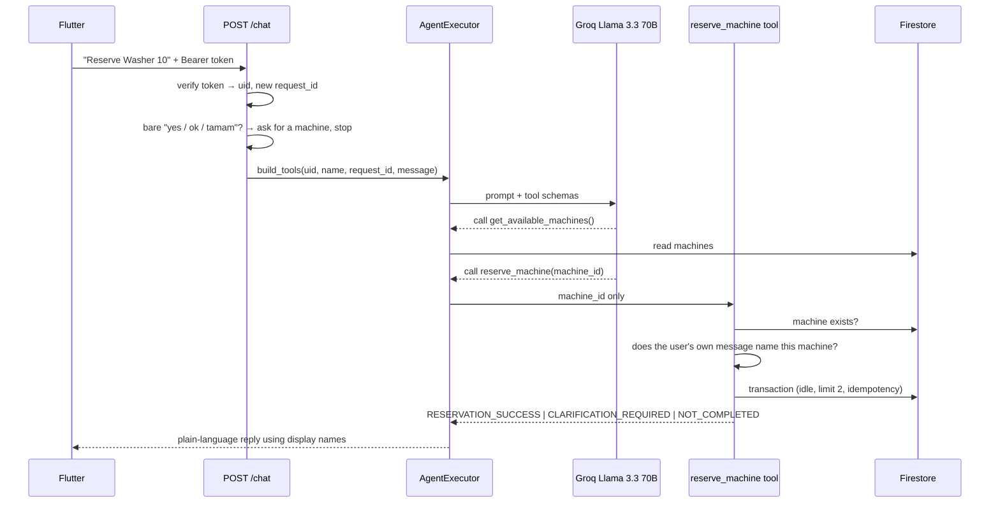
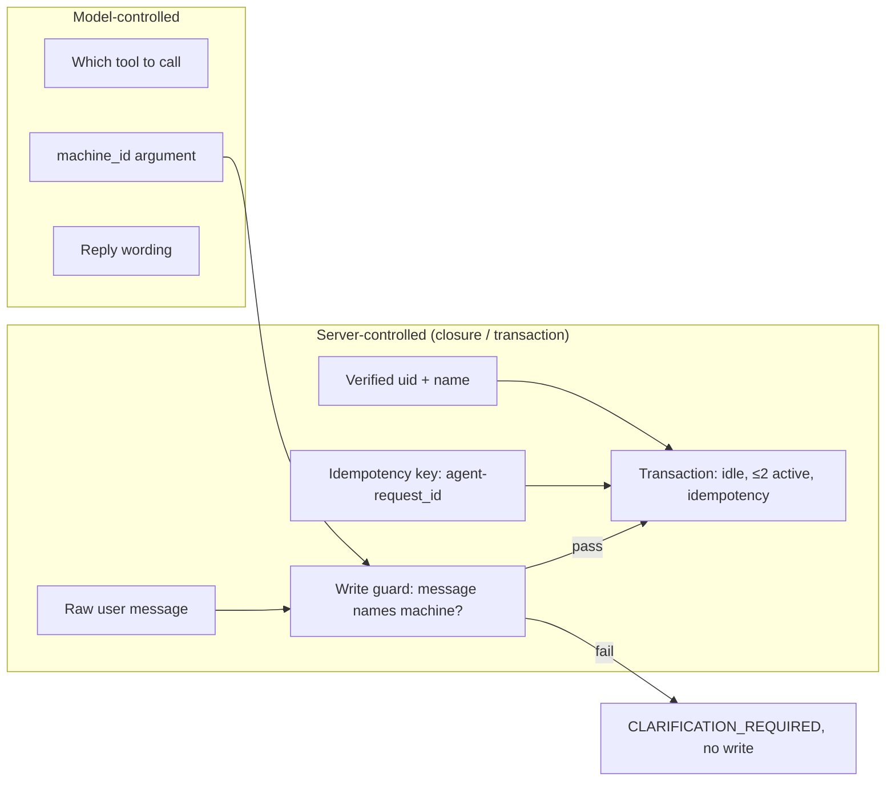

# Authenticated AI Tool-Calling Workflow

The LaundrAI assistant is a LangChain `AgentExecutor` running a custom tool-calling agent on Groq (`llama-3.3-70b-versatile`, `temperature=0`, `max_iterations=6`). It has exactly two tools: `get_available_machines` and `reserve_machine`.

The design goal: **the model chooses *which* tool to call, but never *who* the action is for, and never whether a write is allowed.** Those decisions are made by server code from verified inputs.

## Request Flow

## Trust Boundary

## Design Decisions

### 1. Tools are built per request

`build_tools()` (`backend_service/app/agent/tools.py`) is called once per chat request. It closes over the verified `user_uid`, the user's name, a server-generated `request_id` and the raw user message. None of these appear in the tool schema, so the model cannot supply, read or change them.

`ReserveMachineInput` exposes a single field, `machine_id`. The test `test_llm_visible_schema_contains_machine_id_only` asserts that the tool's argument set is exactly `{"machine_id"}`.

### 2. Deterministic write guard

A model can hallucinate a machine ID, or be steered by injected text into choosing one. Before any write, `reserve_machine` calls `_message_selects_machine(user_message, machine)`, which checks whether the user's **own** message names the selected machine by document ID, display name or number (English and Turkish patterns, for example "washer 10", "machine #10", "10 numaralı makine"). If not, the tool returns `RESERVATION_CLARIFICATION_REQUIRED` and performs no write.

### 3. Bare confirmations never reach the model

`ambiguous_confirmation_response()` (`backend_service/app/agent/service.py`) normalizes the message and, if it is a bare confirmation such as "yes", "ok", "evet" or "tamam", returns a fixed prompt to name a machine. The agent does not run. Because the assistant keeps no conversation memory, a bare "yes" could not refer to an earlier proposal anyway; this makes that explicit.

### 4. Structured status tokens

Tools return machine-readable outcomes rather than free text:

| Token | Meaning |
| --- | --- |
| `RESERVATION_SUCCESS` | The transaction committed and returned the same `machine_id` |
| `RESERVATION_CLARIFICATION_REQUIRED` | No write; a reason (`MACHINE_SELECTION_MISSING`, `MACHINE_ID_INVALID_OR_UNAVAILABLE`, `MACHINE_NOT_SELECTED_BY_USER`, `MACHINE_UNAVAILABLE`, `INVALID_MACHINE_ARGUMENT`) and available display names |
| `RESERVATION_NOT_COMPLETED` | No write; a reason (`ACTIVE_RESERVATION_LIMIT_REACHED`, `REQUEST_ACTION_CONFLICT`, `TRANSACTION_NOT_CONFIRMED`) |

The system prompt forbids claiming success unless the tool returned `RESERVATION_SUCCESS`. If the transaction returns an empty or mismatched result, the tool reports `TRANSACTION_NOT_CONFIRMED` instead of success.

### 5. Internal IDs stay internal

`get_available_machines` returns lines of the form `INTERNAL_ID: machine_010 | DISPLAY_NAME: Washer 10`. The prompt instructs the model to use `INTERNAL_ID` only as a tool argument and to address users by `DISPLAY_NAME`. The success token carries only the display name.

### 6. Idempotent agent retries

The agent's idempotency key is `agent-<request_id>`. If the executor calls `reserve_machine` twice within one chat request, the second call replays the stored result instead of creating a second reservation. `test_same_request_identity_deduplicates_internal_retries` covers this.

### 7. Groq output parser

Groq sometimes sends `arguments: "null"` for zero-argument tools, which LangChain's default tools parser does not accept. A custom `_GroqToolsOutputParser` reads `message.tool_calls`, falls back to the raw `additional_kwargs`, and normalizes null or non-object arguments to `{}` before building `ToolAgentAction`s.

### 8. Bounded execution and safe errors

`temperature=0` and `max_iterations=6` bound the agent loop. Unexpected failures in `/chat` are logged server-side and returned as a generic "The assistant is temporarily unavailable." with HTTP 500.

## Grounding, Not Retrieval

There is no retriever, embedding model or vector store. The assistant is grounded entirely by tool results read from Firestore at request time.

## Limitations

- The assistant can list availability and reserve, but not cancel.
- It keeps no conversation memory between messages.
- Its system prompt states that one active reservation is allowed, while the backend enforces a limit of two.
- Prompt-level rules (English-only replies, plain text, no internal IDs) are instructions to the model and are tested as prompt invariants, not enforced by code. The write path is enforced by code.

Source excerpt: [01 — Request-scoped tools and the write guard](../excerpts/01-request-scoped-tools.md)
