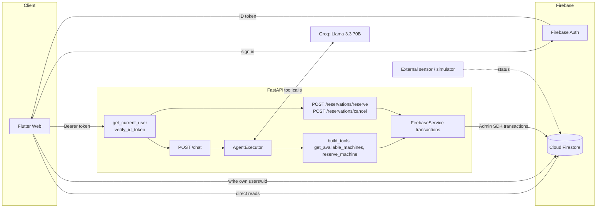
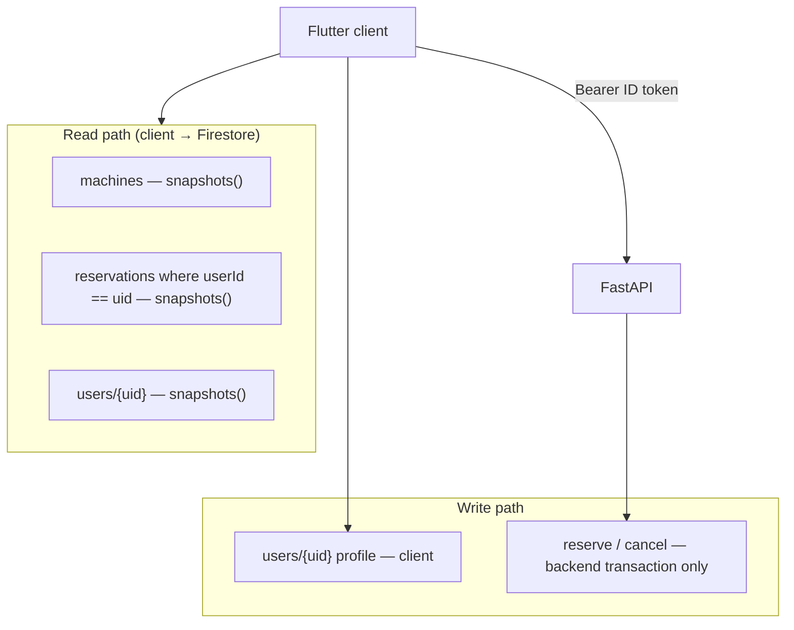
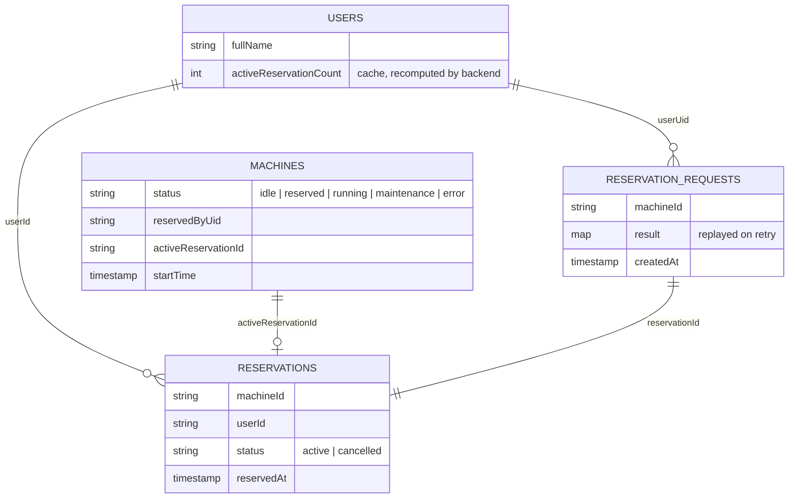
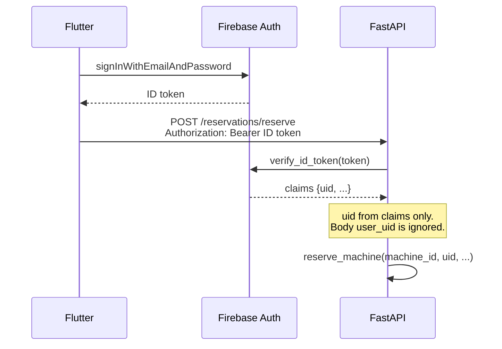

# Architecture

This document describes LaundrAI as implemented in the private source. Paths refer to that source tree; they are cited for traceability and are not included in this repository.

## Components

| Component | Private source location | Responsibility |
| --- | --- | --- |
| Flutter Web client | `lib/` | UI, Firebase sign-in, live Firestore reads, backend calls for every reservation write and chat message |
| Firebase Authentication | external service | Email/password accounts; issues ID tokens |
| Cloud Firestore | external service | `machines`, `users`, `reservations`, `reservationRequests` |
| FastAPI backend | `backend_service/app/` | Token verification, reservation transactions, agent hosting |
| LangChain agent | `backend_service/app/agent/` | Tool-calling agent on Groq (`llama-3.3-70b-versatile`) |
| Sensor / simulator | not part of the application | Writes machine occupancy (`status`) to `machines` |

## System Overview

## Read and Write Paths

The design separates a fast, read-only path from a narrow, authoritative write path.

- **Direct reads.** The client subscribes with `snapshots()` to `machines` (dashboard, machines and schedule screens), to `reservations` filtered by `userId == <uid>` (history, schedule and dashboard), and to its own `users/{uid}` document (profile screen and the app-level `UserNameNotifier`).
- **Client writes.** Only the user's own `users/{uid}`: at sign-up (`lib/services/auth_service.dart`) and on profile edit (`lib/screens/profile_screen.dart`).
- **Reservation writes.** Never written by the client. `lib/services/reservation_service.dart` sends every reserve and cancel request to the backend with a fresh Firebase ID token.

## Data Model

| Collection | Written by | Fields used by the code |
| --- | --- | --- |
| `machines/{machineId}` | backend (reservations), external simulator (`status`) | `status` (`idle`, `reserved`, `running`, `maintenance`, `error`), `name`, `location`, `reservedBy`, `reservedByUid`, `activeReservationId`, `startTime` |
| `reservations/{reservationId}` | backend | `machineId`, `userId`, `userName`, `status` (`active` / `cancelled`), `reservedAt`, `cancelledAt`, `completedAt` |
| `users/{uid}` | client (profile), backend (counter) | `fullName`, `email`, `dormitory`, `note`, `activeReservationCount` |
| `reservationRequests/{sha256}` | backend | `userUid`, `machineId`, `reservationId`, `result`, `createdAt` |

Invariants the code relies on:
- A machine is available only when `status == "idle"`. The UI derives every displayed state from `status` (`lib/models/machine_view.dart`).
- On a reserved machine, `activeReservationId` points to exactly one `reservations` document, and `reservedByUid` names its owner.
- `activeReservationCount` is a cache. The backend recomputes it from machine documents on every reserve and cancel rather than incrementing it.

## Authentication and UID Binding

- `get_current_user` (`backend_service/app/dependencies.py`) verifies the bearer token with the Firebase Admin SDK. Expired, invalid and unverifiable tokens receive distinct 401 responses. See [excerpt 03](../excerpts/03-token-verification.md).
- The routers take the UID only from verified claims. `ReservationRequest.user_uid` is accepted for client compatibility but ignored.
- `ChatRequest` forbids extra fields, so a chat request body cannot carry identity at all.

## Client Structure

- An auth-state router in `lib/main.dart` gates the app shell.
- One shared shell (`lib/widgets/dashboard_navigation.dart`) provides desktop, tablet and compact breakpoints.
- `users/{uid}.fullName` is the single source for the displayed name. `UserNameNotifier` (`lib/services/user_name_notifier.dart`) is provided once at the app root and feeds the profile screen, the sidebar and the dashboard greeting.
- `BACKEND_URL` is a compile-time `--dart-define`. `lib/services/backend_url.dart` rejects a missing, relative or non-`http(s)` value and does not echo the invalid value in its error.

## Known Architectural Gaps

- No backend lifecycle for `reserved` → `running` → `idle`; the external component owns it.
- No Firestore security rules, CI, container setup or deployment configuration in the application repository.
- Reservation-route 500 responses include exception text, and CORS allows all origins.
