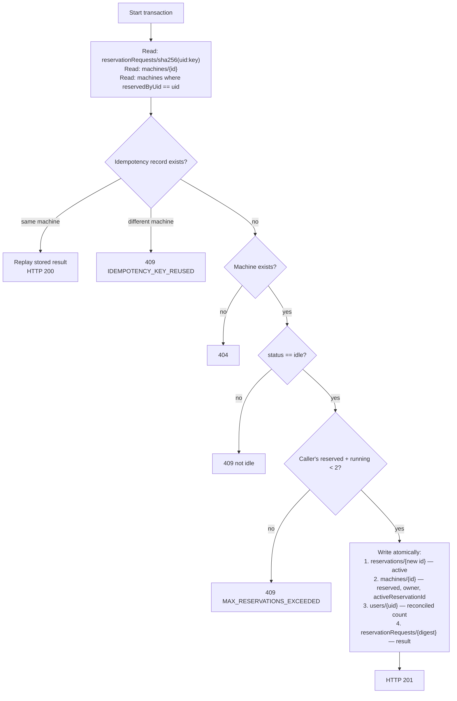
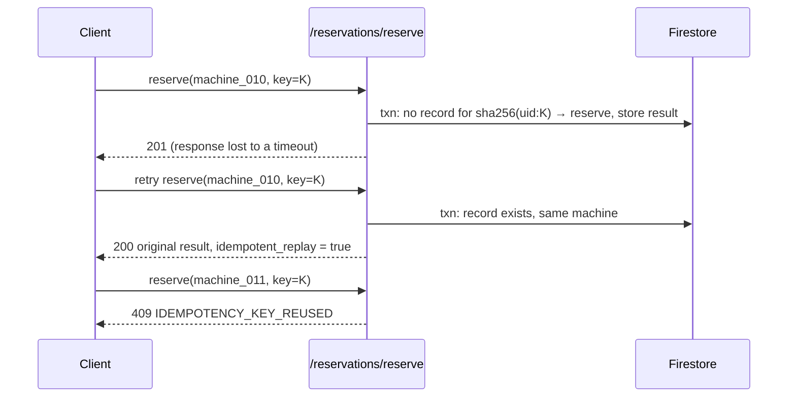

# Reservation Transactions and Security Design

All reservation state changes are made by the FastAPI backend through Firestore transactions using the Firebase Admin SDK. Both the REST endpoints (`POST /reservations/reserve`, `POST /reservations/cancel`) and the AI assistant's `reserve_machine` tool go through the same `FirebaseService` methods (`backend_service/app/services/firebase_service.py`).

## Reserve

`FirebaseService.reserve_machine` runs one transaction. Firestore requires all transactional reads to precede writes, so the method is structured as *read → check → write*.

### Decisions

- **The limit is counted from machine documents**, not from the cached `users/{uid}.activeReservationCount`. This stays correct for reservations created before the counter existed and when the profile document is missing. The counter is then *reconciled* (`set(..., merge=True)` to the computed value) rather than incremented.
- **Machine re-check inside the transaction.** The `idle` check is made on a transactional read of the same machine document the transaction then writes, so Firestore's transaction guarantees prevent two users racing for one machine from both committing.
- **Per-user contention point.** Every reserve transaction also writes the caller's `users/{uid}` document; the source comments describe this as the contention point for concurrent reservations by the same user. This concurrency behaviour is a design intent: it is not verified by the test suite, which mocks Firestore rather than using the emulator.

## Idempotency

- **Client keys.** The Flutter client generates a random UUID v4 per reserve action (`Random.secure()` in `lib/services/reservation_service.dart`) and can pass the same key on a retry. `ReservationRequest` requires the key; a test asserts this.
- **Agent keys.** The assistant uses `agent-<request_id>`, deduplicating retries within one chat request.
- **Record ID.** `sha256(uid + ":" + key)`. Scoping by UID means one user's key cannot collide with another's, and hashing keeps raw client input out of Firestore document paths.
- **Replay semantics.** A replay returns the stored result with `idempotent_replay: true`; the route maps it to HTTP 200 instead of 201.

Source excerpt: [02 — Reservation transaction with idempotency](../excerpts/02-reservation-transaction.md)

## Cancel

`FirebaseService.cancel_reservation` runs one transaction and verifies everything before issuing any write.

| Check | Failure |
| --- | --- |
| Machine exists | 404 |
| Machine `status == "reserved"` | 409 |
| `reservedByUid` is a non-empty string equal to the caller's UID (missing, null or empty fails closed) | 403 |
| Machine has a non-empty `activeReservationId` | 409 |
| A client-supplied `reservation_id`, if any, equals `activeReservationId` exactly | 409 |
| The reservation document (read inside the transaction) exists | 404 |
| Its document ID equals `activeReservationId` and its `userId` equals the caller's UID | 403 |
| Its `machineId` equals the machine | 409 |
| Its `status == "active"` | 409 |

Only after every check passes does it mark the reservation `cancelled`, clear the machine's reservation fields, set the machine to `idle`, and reconcile the user counter.

### The vulnerability this design closes

An earlier version had two authorization gaps in cancellation:

- It used a client-supplied reservation ID, when present, as the document to mark `cancelled`, without reading or verifying that document. A user cancelling their own machine could therefore name another user's reservation and mark it cancelled.
- The owner check was skipped when the machine's `reservedByUid` was missing or empty, so any signed-in user could cancel such a machine.

The fix:

- The machine's own `activeReservationId` is the **only** trusted write target. A client-supplied ID may only *confirm* it; a mismatch is rejected before any reservation document is fetched.
- The reservation document is read **inside** the transaction and its owner, machine and status are verified.
- A missing or empty owner on the machine fails closed instead of comparing equal to an empty UID.

Fifteen regression tests in `backend_service/tests/test_cancel_reservation.py` cover each rejection, and each rejected case asserts that the transaction performed **zero writes** (`update`, `set`, `delete` and `create` all uncalled). See [testing.md](testing.md).

## Security Decisions Summary

| Decision | Threat addressed | Where |
| --- | --- | --- |
| UID taken only from verified Firebase ID token claims | Spoofing another user via request body | `dependencies.py`, `routers/*.py` |
| `ChatRequest` forbids extra fields | Identity smuggled into chat payload | `models/chat.py` |
| Tool identity bound in a closure; schema exposes only `machine_id` | Model or prompt injection acting as another user | `agent/tools.py` |
| Write guard re-reads the user's message | Hallucinated or injected machine ID | `agent/tools.py` |
| Bare confirmations answered before the model | Ambiguous consent turning into a write | `agent/service.py` |
| All reservation writes in backend transactions | Race conditions, double booking, partial writes | `services/firebase_service.py` |
| Hashed, UID-scoped idempotency records | Duplicate reservations on retry; raw input in paths | `services/firebase_service.py` |
| Cancel target taken from the machine, verified in-transaction | Cancelling another user's reservation | `services/firebase_service.py` |
| `BACKEND_URL` must be an absolute `http(s)` URL; invalid value not echoed | Silent `localhost` fallback; config leakage in errors | `lib/services/backend_url.dart` |
| Backend refuses to start without Admin credentials | Running half-configured | `services/firebase_service.py` |
| Admin service-account JSON kept outside the repository | Credential leakage | `.env.example`, `.gitignore` |

## Known Gaps

- Firestore security rules are not part of the application repository. The direct-read design is safe only with rules that restrict reservation reads to their owner and block client writes to `machines` and `reservations`.
- Reservation-route 500 responses include exception text.
- CORS allows all origins.
- Transaction behaviour is tested with mocks, not against the Firestore emulator.
